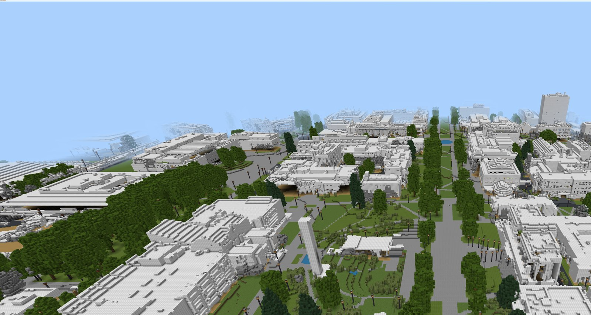
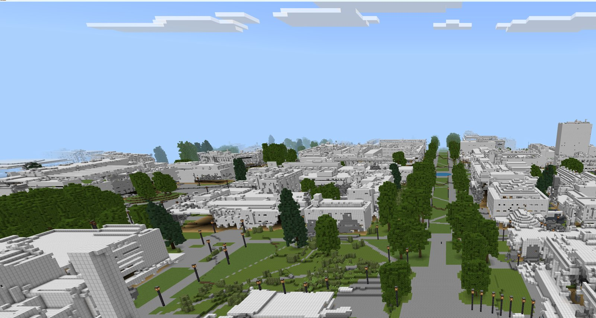
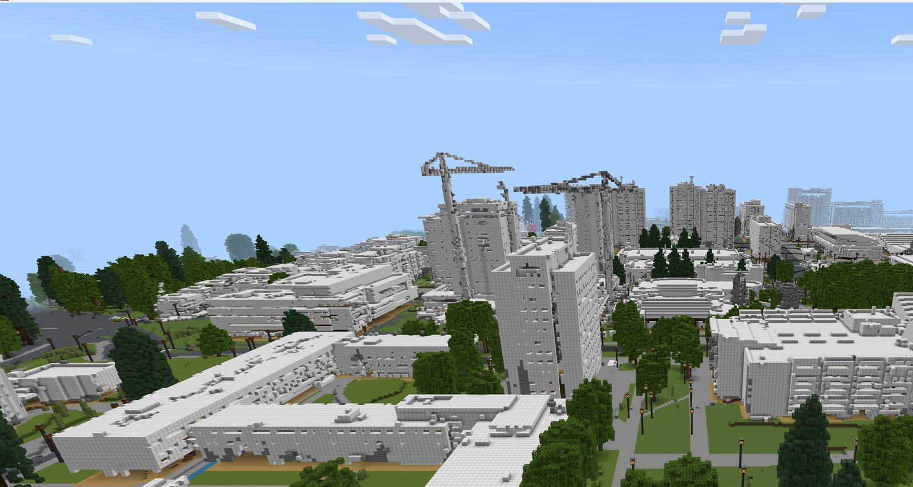
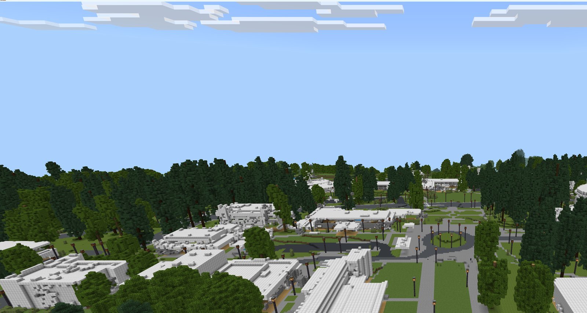

# UBC Campus for Minecraft Bedrock / UBC キャンパスを Bedrock 版で



[English](#english) | [日本語](#日本語)

## English

The University of British Columbia (UBC) Vancouver campus, recreated at 1:1 scale in Minecraft,
converted so it can be played in Bedrock Edition (Windows, iPad, Android and other devices that run Bedrock).

The original world is [ashtanmistal/minecraftUBC](https://github.com/ashtanmistal/minecraftUBC)
(release 3.0.0, Java Edition 1.20.4). It was built from LiDAR point clouds and UBC geospatial data,
and many people built the buildings by hand for Version 2.0. This project only converts that world
to the Bedrock format; the buildings and terrain are unchanged.

### Play

1. Download `ubc_campus.mcworld` (about 80 MB) from [Releases](../../releases)
2. In Minecraft, open **Play**, and on the Worlds tab press **Import World** (top right), then choose the file
3. Open "UBC Campus" from the world list

- Requires Minecraft Bedrock **1.26.50 or later** (the world is saved as `BEDROCK_R26_50`)
- Opening the file directly (double-click, or "Open in Minecraft" on a tablet) also works on many devices.
  On the Windows PC used for testing it did nothing, because no app was set to open `.mcworld` files.
  Import World worked
- Only Windows has been tested so far. iPad and Android have not been tested yet
- Consoles (Switch, Xbox, PlayStation) cannot import files. Upload the world to a Realm from a PC or tablet instead
- With the **Vibrant Visuals** graphics mode, haze turns everything past about 40 blocks white.
  For clear views, switch the graphics mode to **Fancy** under Settings → Video on the title screen
  (it cannot be changed from inside a world)
- Cheats are on. You start in Survival; `/gamemode creative` makes exploring easier

### Highlights

| | | |
|---|---|---|
|  |  |  |
| The tree-lined Main Mall | Towers, with construction cranes | Buildings scattered through the forest |

All shots were taken above the spawn point. `/tp @s 2325 150 -1380 0 32` gives the view at the top of this page.

### World size

- Extent: x −1024 to 6143, z −3072 to 4095 (about 7 km square)
- Spawn: (2317, 29, −1294)

### Convert it yourself (Windows)

```powershell
powershell -NoProfile -ExecutionPolicy Bypass -File scripts\convert.ps1
```

This writes `out\ubc_campus.mcworld`. Use `-Format BEDROCK_R26_40` (for example) to target an older game version.
It uses the [Chunker](https://github.com/HiveGamesOSS/Chunker) CLI; no Java install is needed.
After converting, the script renames the world to "UBC Campus" (Chunker names it "UBC", and the game reads
the name from `level.dat`), adds `assets/world_icon.jpeg` as the world-list icon, and zips the world with `/`
path separators (PowerShell 5.1's `Compress-Archive` writes `\`, which goes against the zip format).

### License and credits

This repository and the released `ubc_campus.mcworld` are licensed under the
**GNU General Public License v2.0**, the same as the original ([LICENSE](LICENSE)).

- Original work: [minecraftUBC](https://github.com/ashtanmistal/minecraftUBC) release 3.0.0 (GPL-2.0)
- Version 3.0: [Ashtan Mistal](https://github.com/ashtanmistal)
- Version 2.0 (outside the manual building): Ashtan Mistal, [Hod Kimhi](https://github.com/hkimhi),
  [Eve Sankar](https://github.com/geminiev), [Bryce Wilson](https://github.com/Bryce-MW)
- The builders of Version 2.0 are listed in the original
  [docs/building.md](https://github.com/ashtanmistal/minecraftUBC/blob/master/docs/building.md)

Changes in this distribution: converted from Java 1.20.4 to Bedrock (`BEDROCK_R26_50`) with Chunker 1.21.0;
renamed the world from "UBC" to "UBC Campus"; added a world icon. Every step is in
[scripts/convert.ps1](scripts/convert.ps1).

- This project is not affiliated with or endorsed by the University of British Columbia.
  The UBC name is not covered by the GPL
- The original project does not state the terms of its source data (LiDAR, UBC geospatial data)
- The images in this repository are in-game screenshots of the converted world
- This world cannot be sold on the Minecraft Marketplace: only Mojang-approved partners can publish there,
  and the world contains other people's work. It is distributed free here

## 日本語

ブリティッシュコロンビア大学（UBC）バンクーバー校のキャンパスを 1:1 で再現した Minecraft の世界を、
統合版（Bedrock 版）で遊べるように変換したもの。

元の世界は [ashtanmistal/minecraftUBC](https://github.com/ashtanmistal/minecraftUBC)
（リリース 3.0.0、Java 版 1.20.4）。LiDAR の点群と UBC の地理データから作られ、
Version 2.0 では大勢の人が建物を手作業で建てている。この変換は、その世界を Bedrock 版の形式に移しただけで、
建物には手を加えていない。

### すぐ遊ぶ

1. [Releases](../../releases) から `ubc_campus.mcworld` をダウンロードする（約 80MB）
2. マインクラフトで「プレイ」→「ワールド」の一覧の右上にある「**ワールドをインポート**」を押し、
   ダウンロードした `ubc_campus.mcworld` を選ぶ
3. 一覧に出た「UBC Campus」を開く

- ファイルのダブルクリックでも取り込める PC があるが、Windows で .mcworld を開くアプリが
  決まっていないと何も起きない（2026-10-11、試した Windows の PC で確認）。そのときは上の「ワールドをインポート」を使う
- 同じ名前のワールドが既にあると、「UBC Campus (インポート完了)」のような名前で取り込まれる
- 変換したゲームの版は 1.26.50（形式 `BEDROCK_R26_50`）。これより古いゲームでは開けない
- 確かめたのは Windows だけ。iPad と Android はまだ試していない
- 家庭用ゲーム機（Switch・Xbox・PlayStation）にはファイルを取り込めない。PC かタブレットから Realms にアップロードして遊ぶ
- 描画モードが「Vibrant Visuals」だと、空気のかすみで 40 ブロックほど先から白く霞む。
  見渡したいときは、タイトル画面の 設定 → ビデオ →「モード」を「描画優先」にする
  （ワールドの中からは切り替えられない）
- チートは有効。最初はサバイバルなので、歩き回るなら `/gamemode creative` が楽

### 見どころ

| | | |
|---|---|---|
|  |  |  |
| メインモールの並木道 | 高層棟。建設中のクレーンもある | 森の中に建物が点在する一帯 |

どれも出現地点の上空から撮った。一番上の画像と同じ眺めは `/tp @s 2325 150 -1380 0 32` で見られる。

### 世界の大きさ

- 範囲: x −1024〜6143、z −3072〜4095（約 7km 四方）
- 出現地点: (2317, 29, −1294)

### 自分で変換し直す

```powershell
powershell -NoProfile -ExecutionPolicy Bypass -File scripts\convert.ps1
```

`out\ubc_campus.mcworld` ができる。ゲームの版に合わせるときは `-Format BEDROCK_R26_40` のように指定する。
変換には [Chunker](https://github.com/HiveGamesOSS/Chunker) の CLI を使う（Java のインストールは不要）。
Windows 専用。

スクリプトは変換のあとに次の 3 つをする。

- ワールド名を「UBC Campus」にする。Chunker は名前を「UBC」にし、ゲームは `level.dat` の名前を使うので、
  `level.dat` と `levelname.txt` の両方を書き換える
- `assets/world_icon.jpeg`（一覧に出るアイコン、800×450）を世界に入れる
- zip の中のパスを `/` 区切りで書く。PowerShell 5.1 の `Compress-Archive` は、zip の規格に反して `\` 区切りで書く

### ライセンスとクレジット

このリポジトリと、配布している `ubc_campus.mcworld` のライセンスは、元の作品と同じ
**GNU General Public License v2.0**（全文は [LICENSE](LICENSE)）。

#### 元の作品

- [minecraftUBC](https://github.com/ashtanmistal/minecraftUBC) リリース 3.0.0（GPL-2.0）
- Version 3.0: [Ashtan Mistal](https://github.com/ashtanmistal)
- Version 2.0（手作業の建築以外）: Ashtan Mistal、[Hod Kimhi](https://github.com/hkimhi)、
  [Eve Sankar](https://github.com/geminiev)、[Bryce Wilson](https://github.com/Bryce-MW)
- Version 2.0 の建物を建てた人の一覧は、元のリポジトリの
  [docs/building.md](https://github.com/ashtanmistal/minecraftUBC/blob/master/docs/building.md) にある

#### この配布物で変えたこと

- [Chunker](https://github.com/HiveGamesOSS/Chunker) 1.21.0 で Java 版 1.20.4 から Bedrock 版（`BEDROCK_R26_50`）の形式に変換した
- ワールド名を「UBC」から「UBC Campus」に変えた
- 一覧に出るアイコン（`world_icon.jpeg`）を足した

建物や地形には手を加えていない。変換の手順はすべて [scripts/convert.ps1](scripts/convert.ps1) にある。

#### 注意

- このプロジェクトは、ブリティッシュコロンビア大学（UBC）とは関係がない。UBC の名称は GPL の対象ではない
- 元の作品は、元にしたデータ（LiDAR の点群、UBC の地理データ）の利用条件を明記していない
- このリポジトリの画像は、変換した世界をゲームの中で撮ったもの

### 配布について

- 公式ストア（Marketplace）には出せない。出せるのは Mojang が認めたパートナーだけで、
  このワールドには他の人の作品も含まれるため
- 無料の配布は、GitHub の Releases に置いている。統合版のワールドとして配る形は `.mcworld`
  （取り込んだ 1 つを遊び続ける）か `.mctemplate`（開くたびに新しいワールドを作る）
- 元の作者の Ashtan Mistal さんへの連絡先は、元の README にある Discord。
  配布について問題があれば、そこで相談する

### 確認すること

- [x] ゲームで開けるか（2026-10-11、1.26.52 で確認）
- [ ] Java 版にしかないブロックが、別のものに置き換わっていないか（看板・扉など）
- [ ] 出現地点がキャンパスの中か
